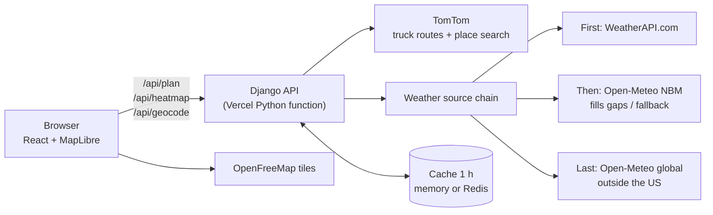
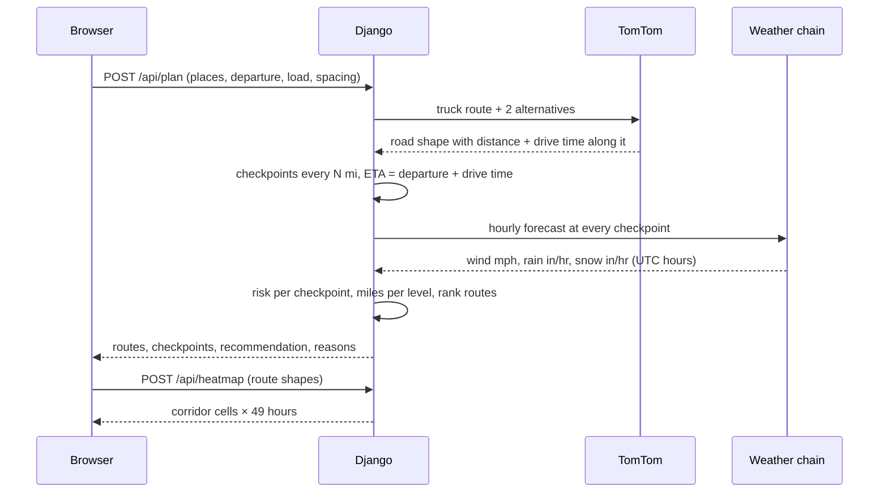
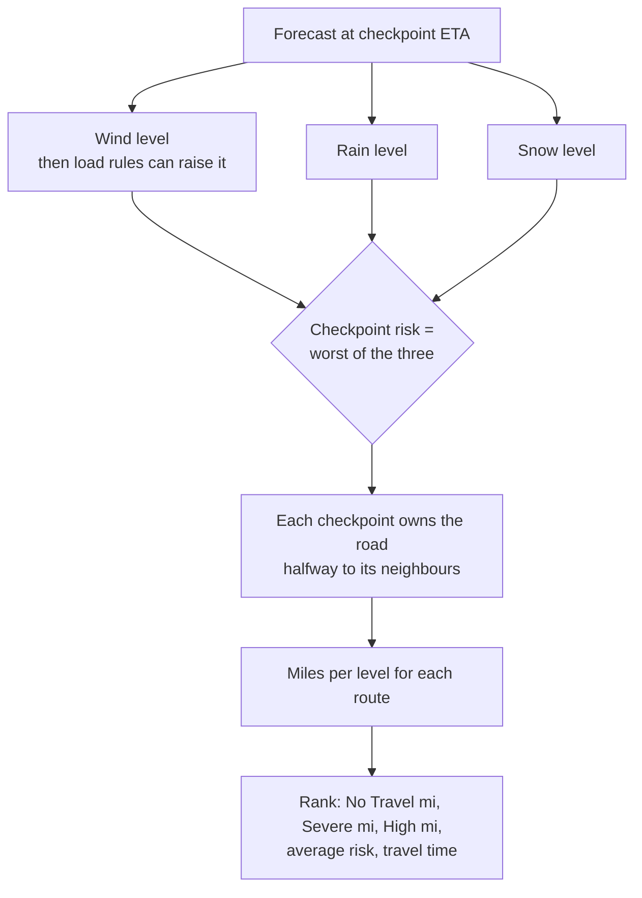
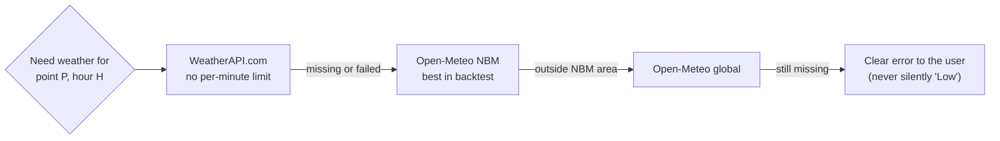

# Weather-Aware Truck Routing

**Live app:** https://weather-aware-truck-routing-xi.vercel.app · **Walkthrough:** _Loom link_

React + Django. Three truck routes, weather checked at each checkpoint **for the hour the truck gets there**,
risk scored with the load rules, and the safest route recommended with a plain-language reason.

**Try it:** click **"Fill in an example trip"**, then **Compare routes**. To see bad weather, plan a trip through
an active storm (calm days are all green — that is the forecast, not a bug).

---

## Brief → implementation

| Brief | Where / how |
|---|---|
| Origin, destination, departure, load | Form with type-ahead place search (TomTom), departure up to 7 days ahead, load in lb |
| 3 route options from a routing API | TomTom **truck** routing (uses the load weight, 65 mph truck speed). If it returns fewer than 3, we ask again through a point beside the main road |
| Weather every 10 / 25 / 50 mi at the truck's ETA | User picks the spacing; each checkpoint gets the forecast **for its own arrival hour** |
| Risk table + load rules | [`backend/core/risk.py`](backend/core/risk.py), pure Python, 100% branch-covered |
| Recommend: Severe → High → avg risk → time | Same order, plus "fewest No Travel miles" checked first; shown as a "Why this route?" table |
| Routes, checkpoints, risk, ETAs, summaries on a map | All 3 routes with risk-coloured checkpoints, a summary label per route, ETA on hover |
| Heatmap with 0–48 h slider | ~150 corridor cells × 49 hours loaded once; the slider only repaints (instant). All / Wind / Rain / Snow views |

## Architecture



One Vercel project serves both: the React build as static files and Django under `/api`. API keys stay on the server.

## How a trip is planned



## Risk and recommendation



**Decisions where the brief is open**

| Question | Decision |
|---|---|
| Edges overlap (rain 0.25 is in Moderate *and* High) | Lower bound inclusive → 0.25 is High. Top of rain/snow follows "> 1.00" / "> 3.0" |
| No Travel isn't in the ranking | Checked first: a route you must not drive can't win |
| "Average risk" | Low 0 … No Travel 4, averaged by miles |
| Which forecast hour | Wind: nearest hour. Rain/snow: the hour containing the ETA (stored at the hour's end, so 13:40 → 14:00) |
| Gross weight for routing | Load + 35,000 lb empty tractor-trailer |
| Truck speed | Capped at 65 mph — without it TomTom's truck mode returned exactly car times |
| Heatmap hour 0 | The departure hour |

## Accuracy

**Our logic — proven by tests.** 132 backend tests (risk table cell by cell and every edge, load rules incl. exactly
30,000 / 40,000 lb, 15,000+ random-input checks, ranking against hand-worked cases, checkpoint geometry, hour matching,
API errors) + 9 frontend tests. Risk engine: **100% branch coverage**. Linters (ruff, oxlint): clean.

**Outside data — measured** ([`backend/accuracy/`](backend/accuracy/), results in `accuracy/results/`):

| Check | Result |
|---|---|
| Our checkpoint ETA vs. TomTom's own time to that point | **0.31 min** average difference (0.08%) |
| Our wind vs. US National Weather Service, same place + hour | **1.2 mph** average, same risk level at **99.8%** of 409 checkpoints |
| Forecast model choice — 30-day backtest vs. 24 airport stations (16,655 hours, 1 day ahead) | NBM beat the default model: wind error **2.73 vs 3.01 mph**, rainy hours caught **72% vs 36%** (more false alarms: 69% vs 53%) |
| WeatherAPI vs. NBM, same place + hour | **2.9 mph** average, same risk level at 100% (calm day); hourly rain aligned at zero shift |



Why WeatherAPI first: Open-Meteo's free tier allows 600 locations per minute, and one trip with its heatmap uses
~300–450, so a reviewer clicking quickly could hit it. WeatherAPI has no per-minute limit. The trade-off: it doesn't
publish past forecasts, so only NBM could be backtested.

Safeguards: units are checked on every response (mph / inch), all time maths is in UTC, missing data is an error
rather than "Low", and invalid responses are retried or handed to the next source.

## Code map

```
backend/
  core/        risk rules, ranking, route geometry, ETA → forecast hour    (pure Python)
  providers/   TomTom / OSRM routing, place search, weather source chain, cache
  api/         Django REST endpoints + trip planning service
  accuracy/    backtest + live checks, saved results
  tests/       132 tests
frontend/src/
  components/  form, place search, results, ranking table, map, time slider
  lib/         validation, formatting, plain-language explanations, geometry
api/index.py   Vercel entry point · vercel.json   build + routing
```

## Run locally

```bash
cd backend && python3 -m venv .venv && .venv/bin/pip install -r requirements.txt -r requirements-dev.txt
cp .env.example .env    # TOMTOM_API_KEY, WEATHERAPI_KEY (without keys: free demo routing + Open-Meteo)
.venv/bin/python manage.py runserver 8000
```

```bash
cd frontend && npm install && npm run dev    # http://localhost:5173 (proxies /api to :8000)
```

Tests and linters:

```bash
cd backend && .venv/bin/python -m pytest tests --cov=core --cov-branch && .venv/bin/ruff check .
cd frontend && npm test && npx oxlint src
```

**Deploy (Vercel):** import the repo (preset "Other"), set `TOMTOM_API_KEY`, `WEATHERAPI_KEY`, `DJANGO_SECRET_KEY`,
`DJANGO_DEBUG=0` (optional `REDIS_URL`), deploy.

## Known limits

- Forecasts can be wrong at an exact place and hour; the backtest shows how often.
- Average risk is per mile, so a much longer route dilutes the same bad stretch (only matters when Severe and High tie).
- Driver rest breaks aren't modelled; ETAs assume continuous driving.
- Times are shown in the viewer's time zone.
